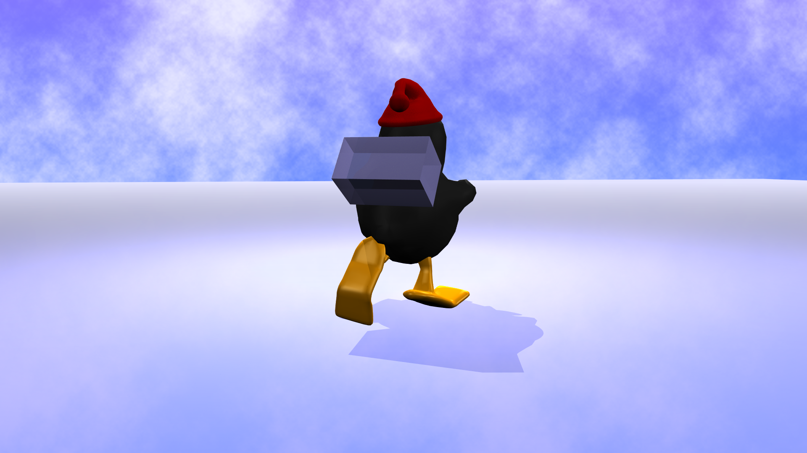

# snowballz

This is an attempt to revive a game that is older than me.

Description
-----------
Snowballz is a fun little game in which you engage your group of penguins in a snowball fight.

Play
----
Download the package for your system from the releases and unpack it:

| System | Package | Start |
|--------|---------|-------|
| Windows (64-bit) | `snowballz-<version>-windows-x64.zip` | double-click `snowballz.exe` |
| macOS (Apple Silicon and Intel, 10.13+) | `snowballz-<version>-macos.zip` | open `Snowballz.app` |
| Linux (x86-64, glibc 2.34+: Ubuntu 22.04 / Debian 12 / Fedora 35 or newer) | `snowballz-<version>-x86_64.AppImage` | make it executable (Properties, or `chmod +x`), then double-click |
| Linux, as a folder | `snowballz-<version>-linux-x64.tar.gz` | run `./snowballz` |

Everything the game needs is in the package (SDL2 is included, the music
decoder is built in). Each package has a `PLAY.txt` with the details: the
first-start warning Windows and macOS show for unsigned programs, adding the
game to the Linux applications menu, and so on.

Build from source
-----------------
This is Snowballz 0.9.5.1, ported from Python 2 + rabbyt/OpenGL to Python 3 +
pygame, and now to **Rust**.

You need:

* **Rust**, a current version from <https://rustup.rs> (built and tested with 1.97).
  On Windows, if `cargo` says *link.exe not found*, either install the
  *Build Tools for Visual Studio* with "Desktop development with C++", or use
  Rust's GNU toolchain for this folder:
  `rustup toolchain install stable-x86_64-pc-windows-gnu` then
  `rustup override set stable-x86_64-pc-windows-gnu`.
* the **SDL2** library, which the game loads when it starts:

  | System | Install |
  |--------|---------|
  | Debian / Ubuntu / Mint | `sudo apt install libsdl2-2.0-0` |
  | Fedora | `sudo dnf install SDL2` |
  | Arch | `sudo pacman -S sdl2` |
  | macOS | `brew install sdl2` |
  | Windows | put `SDL2.dll` (from <https://github.com/libsdl-org/SDL/releases>, an SDL **2**.x release, file `SDL2-<version>-win32-x64.zip`) in this folder |

Then, in this folder:

    cargo run --release                          # the menu
    cargo run --release -- --single whiteforest  # skip the menu
    cargo run --release -- --server [map]        # host an online game
    cargo run --release -- --client <code or address>   # join one

The program is `target/release/snowballz`. It looks for `data/` and `maps/` in
the current folder, then next to the program and in the folders above it, so
you can start it from anywhere inside this folder. On Windows, release builds
open no console window (debug builds do).

The game has **no Rust dependencies** (no crates): SDL2 is opened at run time,
and the PNG, JPEG, zip, TrueType and **Ogg Vorbis** decoders are part of the
game. `cargo build` works offline and needs no `-dev` packages.

Making releases
---------------
* **All three systems at once (GitHub):** put this folder in a GitHub
  repository. `.github/workflows/release.yml` builds and tests the game on
  Linux, Windows and macOS and packages each with SDL2. Publish a release
  (*Releases -> Draft a new release*, tag such as `v0.9.6`) and the three
  packages are added to it after about 10 minutes. You can also start it by
  hand (*Actions -> Release -> Run workflow*): give it the tag of an existing
  release to add (or refresh) the packages there, or leave the tag empty and
  download the packages from the run.
* **On your own computer:**
  * Linux: `bash tools/make-release.sh linux` (bundles your system's SDL2;
    also makes the AppImage if `appimagetool` is installed)
  * macOS: `bash tools/make-release.sh macos` (downloads SDL2.framework; run
    `rustup target add aarch64-apple-darwin x86_64-apple-darwin` first for an
    app that runs on both kinds of Mac)
  * Windows: `powershell -ExecutionPolicy Bypass -File tools\make-release.ps1`
    (uses `SDL2.dll` from this folder, or downloads it)

  The package lands in `dist/`.
* The version in the package names and in the game is the one in the
  `VERSION` file (it can have four numbers, like `0.9.8.1`); use the same
  number for the release tag (`v0.9.8.1`).

Loadout
-------
Before a match you choose how your igloo's penguins are split between
**snowballers** (they fight and capture igloos) and **workers** (they gather
fish and crystals). The map decides how many penguins each igloo gets; you
decide the mix, from all workers to all snowballers.

* Single player: on the map page, with the **-** and **+** buttons under the
  map's description.
* Online: in the lobby, with the **-** / **+** buttons or the Left / Right
  arrow keys, until the host presses `S`. Every player chooses their own, and only
  sees their own.
* Your choice is remembered for each map (in the settings file). Each AI
  player gets a random mix (a quarter to four fifths snowballers).

Alerts
------
When one of your igloos is being taken, or your penguins are hit somewhere
you aren't looking, an alert shows at the top left with a warning sound.
Click it, or press `J`, to move the view there. **Sound effects** in
Settings sets the warning sounds' volume. They are made from scratch by
`tools/sounds/make_sounds.py` into `data/sounds/` (16-bit WAV files: you
can replace them with your own).

Computer players
----------------
Each computer player has a level: **Easy**, **Normal** or **Hard**. New
games use the level set in Settings (*Computer players*); during a match
the host (or the single player) can change any of them in the players
panel (`P`). Every level gathers, attacks and makes alliances; on top of
that:

* They follow a strategy: building up, attacking when their snowballers
  outnumber the strongest enemy's, and defending when enemies come near
  their igloos (sending snowballers home, into the igloo if it is being
  taken).
* Normal and Hard also pick up power-ups, switch penguins between worker
  and snowballer to fit the strategy (paying the fish like a player), and
  build snow walls facing their nearest enemies (Normal one section, Hard
  up to three, turned into ice when there is crystal to spare).
* Easy thinks slowly and aims worse than a player; Hard thinks fast,
  attacks sooner, and aims better.

Your own snowballers no longer all run home when one of your igloos is
being taken: the alert tells you, and you decide who goes.

Start and end of a match
------------------------
Every match starts with a 3, 2, 1, Go! countdown: nobody moves until "Go!",
but you can look around and give orders already.

Every player gets a random team colour at the start of each match (red, blue,
green, yellow, purple, orange, cyan, pink, brown, lime, navy or olive), so the
colours no longer depend on the map or the igloo you start in.

After the match, the winner / loser screen lists every player's numbers:
enemy penguins their snowballs froze, their own penguins frozen, snowballs
thrown and the share that were direct hits, loads of fish and crystal
brought home, igloos taken, wall tiles built and power-ups picked up, with
the map and how long the match took. In an online game the host counts and
everybody sees the same numbers.

Power-ups
---------
Every minute as many power-ups as the map has drop at random places (the
countdown is at the top of the screen). A snowballer picks one up by walking
over it and keeps it until it is frozen: then the thrower takes it, or it
drops in the snow.

* **Rapid fire** (red diamond): makes snowballs three times as fast and keeps
  two in hand when it isn't busy.
* **Range** (yellow circle): throws from further away, and its snowballs
  always find their target.
* **Defense** (blue shield): 4 more warmth, near misses don't hurt, direct
  hits take 1 warmth instead of 3, and it warms up by itself outside the
  igloo (1 warmth every 15 seconds).

Each drop picks every power-up's kind at random, so each of the three is
equally likely: a 1 in 3 chance each.

Alliances
---------
Press `P` in a match for the alliances panel: every other player, with an
**Offer alliance** button. An offer to you pops up at the top of the screen:
**Accept** (`Y`) or **Reject** (`N`); unanswered, it runs out after a minute.

* Accepting costs both sides 10 fish (from their igloos).
* Allies' penguins don't throw at each other, an ally's stray snowball
  doesn't hurt, and allies can't take each other's igloos.
* Allying with a player who already has allies joins the whole alliance.
* Allies win together: on conquer maps when the alliance holds every igloo,
  on crystal maps when the alliance has the amount times its size (60 for
  two players on a "first to 30" map; the crystal list at the top right
  shows each alliance as one row).
* The AI players make and answer offers too (and hold grudges). Every offer,
  answer and new alliance is announced in the chat.

Snow walls
----------
Workers build walls out of snow bricks, one 8-tile **section** at a time.
Select some workers and press `B`: a section's outline follows the mouse
(green where it fits, red where it doesn't). `R` or the mouse wheel rotates
it (east-west, north-south or either diagonal); a click puts it down. Hold
`Shift` to place several in a row (line them up end to end for a longer
wall); right click (or `Escape`) stops.

* **Snow brick wall**: free (snow is everywhere). Each 8-tile section takes
  30 seconds of work, so two workers build it in 15 seconds and three in 10.
  The bricks go up row by row along the whole section, with one progress
  bar over its middle.
* **Ice wall**: select workers, press `U` and click a finished section of
  your snow wall. Each section costs 1 crystal and takes 15 seconds of work
  (shared the same way). Crystal counts towards a crystal map's goal, so
  ice walls are a trade-off there.
* Penguins find their way round walls: sent to the other side of one, they
  walk round its end (or through a gap) instead of pacing along it.
* A finished wall blocks the way for every penguin, yours too (leave a
  gap, or take a tile of it down: right click it while planning with `B`).
  Walls can't go on trees, ice pinnacles, fish holes or crystal, or within 2
  tiles of an igloo door.
* An enemy snowball aimed at a penguin up to 2 tiles behind the wall hits
  the wall instead. Each tile of snow bricks takes 8 hits, of ice 20, so
  walls are breached a tile at a time; damaged tiles look battered, and
  right-clicking one with workers patches it up for free (2 seconds of work
  a hit). Your own side's snowballs
  fly over your walls.
* Snowballers knock down an enemy wall tile that is in their way, or the one
  you right-click with them selected (before anything else).
* Each wall's ends carry a small flag in its owner's colour. The AI players
  don't build walls, but their snowballers knock them down.

Map editor
----------
*Map editor* in the main menu makes new maps or changes existing ones.

* **New map** (80, 120 or 160 tiles square) or **Change a map**.
* Tools on the left: **Snow** / **Ice** (the ground), **Raise** / **Lower** /
  **Smooth** (hills; hold the button), **Trees** (on snow), **Pinnacles** (on
  ice), **Fish**, **Crystal**, **Eraser**, **Igloo** (one per player, at least
  2), and the **Rapid fire** / **Range** / **Defense** power-ups. The left
  button paints, the right button removes things; `-` / `+` (or `[` `]`)
  change the brush. In the game only the number of power-ups counts: that
  many are dropped at random places, of random kinds, every minute.
* The mouse wheel zooms, the middle button or the arrow keys / `W` `A` `S` `D`
  move the view, `Home` shows the whole map, `Ctrl+Z` undoes, `Ctrl+S` saves.
* Every igloo gets the land nearest to it as its territory (shown tinted).
* **Map settings**: the name and description, the victory (take every igloo,
  or be the first to gather a number of loads of crystal / fish) and the
  penguins each igloo starts with.
* **Music** (in *Map settings*): `<` / `>` pick the game's usual music or
  one of its tunes; to give the map its own music, drag an Ogg Vorbis
  (`.ogg`) file from your file manager onto the editor window. It is saved
  inside the map (up to 25 MB), so it plays for whoever has the map.
  **Listen** plays the choice.
* **Import a map...** (on the editor's first page) brings in a map from your
  computer: a Snowballz map `.zip` (from a friend, a download, another
  computer). It opens your computer's file chooser (on Linux this needs
  `zenity` or `kdialog`); you can also just drag the `.zip` onto the
  editor's window. The map is checked, then copied into your maps folder
  under a name of its own (it never replaces a map that is there), and it
  shows up in the editor and in the game's map list.
* **X** next to one of your own maps (in *Change a map*) deletes it, after
  you confirm. The game's own maps can't be deleted; deleting your changed
  copy of one brings the original back.
* **Save** puts the map in your own maps folder (`~/.snowballz_maps`; Windows
  `%APPDATA%\SnowballZ\maps`): it appears in Single Play and when hosting. A
  changed game map is saved there too, so the original stays as it was.
* **Test play** saves and starts a single player game on the map; leaving the
  game (`Escape` -> *Quit game*) returns to the editor.
* To play a custom map online, every player needs the map file: send it to
  your friends and they put it in their own maps folder.

Controls
--------

| Input | Action |
|-------|--------|
| left drag | select penguins |
| right click | send the selected penguins there. What you click decides what they do: workers gather from a fish hole / crystal; snowballers chase an enemy penguin and throw at it until it is frozen; any penguin picks up a power-up or enters an igloo. Clicking on a penguin's or a crystal's picture counts, not only the tile under its feet |
| middle click | same, running |
| right click the same place twice | same, running: they go there without stopping to fight |
| click a penguin type in the panel (bottom right) | keep only that type selected; the arrow disbands them |
| `O` | disband the selected penguins |
| `P` | the alliances panel; `Y` / `N` accept / reject an alliance offer |
| `J` | look where the last alert (igloo being taken, penguins under attack) happened; or click the alert |
| `B` (workers selected) | place an 8-tile snow wall section: `R` / mouse wheel rotates, click puts it down, `Shift` keeps placing; right click your wall to take it down |
| `U` (workers selected) | turn your snow wall into ice: click a section (1 crystal each) |
| right click a wall | workers: build / patch up / finish turning it into ice; snowballers: knock it down |
| `X` | change the class of the selected penguins (worker ⇄ snowballer): they go into their igloo, warm up, and 10 seconds later come out as the other class; 1 fish each from the igloo |
| `Ctrl`+`1`..`9` | make the selected penguins a squad (a penguin is in one squad at a time; its number shows on it) |
| `Shift`+`1`..`9` | add the selected penguins to that squad |
| `1`..`9`, or click a squad's button (bottom left) | select that squad; press / click twice quickly to look at it |
| `Space` | hide / show the minimap (bottom right): click or drag on it to move the view, right click to send the selected penguins there |
| mouse wheel / `Page Up` / `Page Down` | zoom (in to 3x, out until the map just fits) |
| move the mouse to the screen edge / arrow keys / `W` `A` `S` `D` | scroll |
| `Home` | jump to your igloo |
| `Enter` | chat; `>name message` whispers to one player (`Tab` completes the name) |
| `Ctrl`+`V` (Mac: `Cmd`+`V`) | paste into the chat line (opens it if needed) |
| `Ctrl`+`C` | copy the newest chat message (while typing: copy the line you typed; `Ctrl`+`X` cuts it) |
| `.` / `,` | reply to the last whisper / whisper the last player again |
| `C` | clear the chat messages |
| `F3` | show / hide the FPS counter |
| `F11` | fullscreen on / off (works in the menu too) |
| `Escape` | the game menu: *Return to game*, *Settings* (sound, graphics), *Quit game*; a single player game pauses while it is open |

Settings
--------
Settings are kept in `~/.snowballz.ini` (Windows: `%APPDATA%\SnowballZ.ini`),
the same file the Python version used.

* **Game scale**: `Auto` picks a zoom from your screen height (1x up to 768 px,
  1.5x at 1080p, 2x at 1440p); `1x`, `1.5x`, `2x` force one.
* **Resolution** and **Fullscreen** apply at once (fullscreen keeps the game's
  resolution and scales it to the monitor, keeping the aspect ratio).
* **Volume** and **Music**: drag the sliders (or use the mouse wheel on
  them); the change is heard at once. The game's only sounds are its music,
  so both set the music's loudness for now; *Volume* is the overall level.
* **Smooth scaling**, **Frame rate** (60, 35 = the original, unlimited),
  **Day/Night cycles**, **Smoke**, **Footprints**, **Snowball detail**,
  **Name**, **Ice Cursor**.

Online games
------------
The computer that hosts a game is the server; nothing else is needed.

* **Host:** *Online -> Host a game*, pick a map. The lobby shows how friends
  can join, each with a **Copy** button:
  * **Game code** (like `KQ7-XM4`) - when the game has a relay server (see
    below). Friends type the code; nobody needs router settings, and it works
    behind any router or internet provider.
  * **Internet** - your public address. The game asks your router to open TCP
    port **5555** for it (UPnP). If 5555 is already forwarded to another
    computer, the router gives the game the next free one and the address
    includes it (`203.0.113.7:5556`).
  * **Same network** - for players at home / on the same Wi-Fi.
  * **IPv6** - shown when your computer has a public IPv6 address; works if
    both of you have IPv6 and the router lets the game in.

  Press `S` when everybody is in. The game is closed at the relay and the
  port on the router again when the game ends (also when the window is
  closed).
* **Join:** *Online -> Join a game*, type or paste (`Ctrl+V`, or `Cmd+V` on a
  Mac) the code or address and press `Enter`. Addresses can be
  `203.0.113.7`, `203.0.113.7:5556`, `[2001:db8::5]:5555` or a host name. The
  last one is remembered.
* **If the router can't open the port** (UPnP is off in its settings, or
  there is none) and there is no game code, the lobby says so: forward TCP
  port 5555 to the address shown under *Same network* in the router's
  settings, and give friends your public address. If your internet provider
  puts several homes behind one public address (carrier-grade NAT; the lobby
  detects it), nobody can reach you over IPv4: use a game code, IPv6, or a
  virtual-LAN program such as ZeroTier or Tailscale.
* The first time you host, Windows and macOS ask whether the game may
  accept connections: allow it. On Linux with a firewall (`ufw`, `firewalld`),
  allow TCP port 5555.
* Automatic port opening can be turned off with `upnp = 0` in the `[network]`
  section of the settings file.
* Joining gives up after 6 seconds, and the menu says why (nobody is hosting
  there, no answer, unknown name...).
* A player who loses their last igloo is not thrown out: they keep watching
  the game (a *Spectating* banner shows it) until somebody wins, or leave with
  `Escape` -> *Quit game*. This includes the host, whose computer keeps the
  game going for the others.
* If a player leaves, the host's AI takes over their penguins and the game goes
  on. If the host leaves, the other players are sent back to the menu with a
  message.
* Someone joining a match that is already running gets a free igloo or one
  played by the AI (never another human's) and goes straight into the game,
  with the penguins that igloo has. The host's chat shows the address again
  when the match starts.
* Everybody needs this version of the game. Its network messages are those of
  the Python version plus one for loadouts, so it can't play with the Python
  version.
* `snowballz --server [map]` hosts without the menu (for example on a
  server); the code and addresses are printed in the terminal.

Game codes: the relay server
----------------------------
Game codes go through a **relay server**, a small program
(`snowballz-relay`, in `src/bin/`) on a computer the internet can reach,
for example a small cloud server. The host and the players all connect *to*
the relay, and it passes the game's traffic between them, so no router needs
any settings.

* Each release has `snowballz-relay-<version>-linux-x64.tar.gz` and
  `-linux-arm64.tar.gz` (static programs for any Linux). Their `README.txt`
  explains the setup: copy the program, start the included systemd service,
  and allow TCP port 5555 in the server's firewall.
* Then put the server's address (`host:port`) in the **`RELAY`** file and make
  a release: every copy of that release shows a game code when hosting.
  Without an address in `RELAY` the game simply has no codes (addresses work
  as before). A player can also set or override it in the settings file:
  `[network]` `relay = host:port` (`off` turns codes off).
* The host and the players must use the same relay. One small relay serves
  many games; it keeps no files and logs no addresses.
* `cargo run --release --bin snowballz-relay -- --port 5555` runs one for
  testing (`SNOWBALLZ_RELAY=127.0.0.1:5555` points the game at it).

If the game crashes
-------------------
A crash writes a report (game, system, SDL version, video driver, renderer and
the full backtrace) to `~/.snowballz_crash.log` (Windows:
`%APPDATA%\SnowballZ_crash.log`) and shows a message box. An error inside a
single frame is logged and the game carries on; only a frame that keeps
failing ends it. Please send that file with bug reports.

How the Rust version is built
-----------------------------

| Python module | Rust module |
|---------------|-------------|
| `snowballz.py` (Main / ServerMain / ClientMain) | `main.rs`, `game.rs` |
| `gfx.py`, `textures.py`, `font.py` | `gfx.rs` (SDL's GPU renderer), `ttf.rs`, `image.rs`, `png.rs`, `jpeg.rs`, `inflate.rs` |
| `terrain.py` | `terrain.rs` (textured triangles, like the original OpenGL mesh) |
| `map.py`, `data.py`, `player.py`, `plugin.py` | `world.rs`, `zip.rs`, `ini.rs` |
| `unit.py` | `unit.rs` |
| `snowball.py` | `snowball.rs`, `effects.rs` |
| `buildings/*` | `igloo.rs` |
| `ai.py` | `ai.rs` |
| `networking.py` | `net.rs` (a reader and a writer thread per connection; IPv4 + IPv6) |
| - | `upnp.rs` (router port forwarding: SSDP + SOAP), `online.rs` (hosting status), `relay.rs` + `relay_common.rs` (game codes), `bin/snowballz-relay.rs` (the relay server) |
| `ctrl.py` | `ctrl.rs` |
| `display.py` | `display.rs` |
| `selectctrl.py`, `minimap.py` | `hud.rs` |
| `events.py`, `plugins/*` | `plugins.rs` (power-ups, conquer and gather victories) |
| `menu.py`, `ui.py`, `backgrounds.py` | `menu.rs`, `ui.rs`, `backgrounds.rs` |
| `settings.py`, `crashlog.py` | `settings.rs`, `crashlog.rs` |
| pygame.mixer | `audio.rs` + `vorbis.rs` (the game's own Ogg Vorbis decoder, SDL audio) |

* Drawing uses SDL's accelerated renderer (OpenGL / Direct3D / Metal), so the
  game runs at full speed even zoomed out with every penguin on screen.
  With SDL older than 2.0.18 the terrain is drawn as flat tiles (no elevation
  shading).
* The game logic is a line-by-line port: same rules, same AI, same maps and
  plugins, and the fixes from the Python 3 version (frozen penguins don't block
  the igloo door and thaw there after 30 s, time-based animation, clamped
  network values, zoom limits, the selection panel, ...).
* Old `data/convert*.py` and `tools/make_backgrounds.py` stay with the Python
  version; the `bg_*.jpg` widescreen backgrounds they made are included here.

Tests
-----

    cargo test --release

checks the decoders against every game image, map and music track (the Ogg
Vorbis decoder matches libvorbis to within float rounding), the font, and that
the network messages are byte-for-byte the Python version's (plus the
loadout message), the router port forwarding against a pretend router,
IPv4 / IPv6 hosting, and the relay server (a host and a player talking
through it). For automated play
the game reads a few environment variables: `SNOWBALLZ_AUTOPLAY=1` (the AI
plays for you), `SNOWBALLZ_TIMESCALE=1000` (10x game speed),
`SNOWBALLZ_QUIT_AFTER=<ms>`, `SNOWBALLZ_STATS=<ms>`,
`SNOWBALLZ_SHOTS=<ms>:<file.png>,...`, `SNOWBALLZ_SKIP_END=1`,
`SNOWBALLZ_AUTOSTART=<ms>` (a server starts on its own),
`SNOWBALLZ_NO_MUSIC=1`, `SNOWBALLZ_CONFIG=<ini file>`, `SNOWBALLZ_NO_UPNP=1`,
`SNOWBALLZ_SSDP_ADDR=<ip:port>` / `SNOWBALLZ_UPNP_LOCATION=<url>` (talk to a
test router instead of the real one), `SNOWBALLZ_RELAY=<host:port>`.

License
-------
GPL v2 or later, like the original game - see `LICENSE`.
